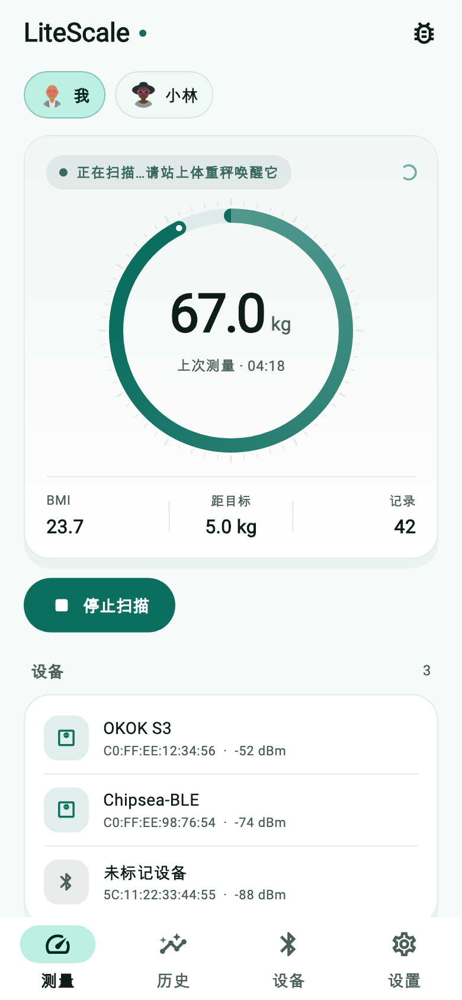
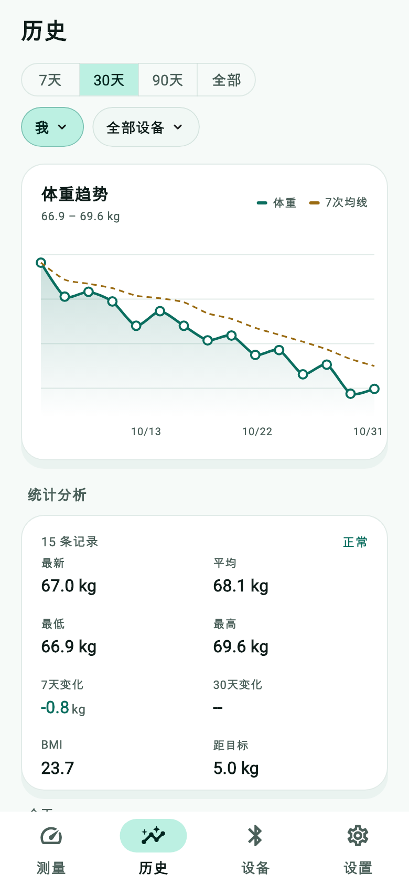
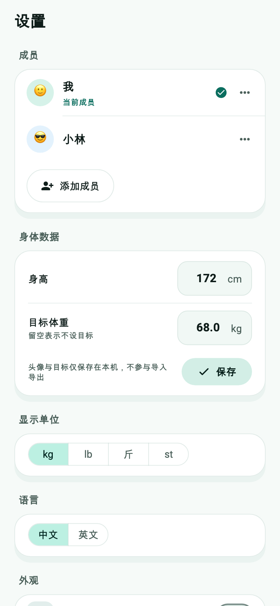

# LiteScale

[](https://flutter.dev/)
[](https://dart.dev/)
[](LICENSE)

## Project Overview

This project is a Flutter application designed to connect with an OKOK-compatible smart scale (or one based on Chipsea chipsets) via Bluetooth Low Energy (BLE). The application provides a user-friendly interface to discover the scale, connect to it, and receive real-time weight data, parsing and displaying it clearly. This project aims to offer an alternative to relying solely on official scale applications, allowing users and developers to integrate weight data into their custom systems.

## Key Features

* **Device Discovery:** Efficient scanning for Bluetooth devices to identify compatible smart scales.
* **Connection & Pairing:** Establishing a stable and reliable BLE connection with the scale.
* **Data Reception:** Receiving raw weight data from the scale as soon as a measurement is taken.
* **Protocol Parsing:** Decrypting the raw data received from the scale using the custom OKOK Protocol (version `0xCA`), including:
    * Checksum (XOR) validation for data integrity.
    * Extracting raw weight values.
    * Identifying measurement units (KG, LB, Jin, ST:LB).
    * Determining the number of decimal places for the weight.
* **Intuitive UI:** Displaying current weight and connection status with a modern and intuitive design.
* **Bluetooth State Management:** Checking Bluetooth adapter status and prompting the user to enable it if turned off.

## Challenges Encountered

* **Custom Communication Protocol:** A significant challenge was understanding and reverse-engineering the OKOK BLE Protocol, for which comprehensive public documentation is scarce. The project relied on partial documentation and analyzing device behavior.
* **Connection Establishment:** The scale's BLE interface might require a specific sequence or "handshake" to establish a successful connection, which could lead to errors like `ANDROID_SPECIFIC_ERROR` or `Timed out`. This necessitates precise experimentation and inspection using tools like nRF Connect.

## Prerequisites

To build and run this project, you will need:

* [Flutter SDK](https://flutter.dev/docs/get-started/install) (version 3.x.x or later recommended)
* An Android device (Android 6.0 Marshmallow or newer) or iOS device (iOS 11.0 or newer) with BLE support.
* An OKOK / Chipsea compatible smart scale (e.g., "Chipsea-BLE").

## How to Build Release Artefacts

Version and build number live in `pubspec.yaml` (`version: 1.0.6+6`). Every script
sources `scripts/common.sh`, which derives the names from the project itself
instead of hard-coded strings, so a rename does not require touching the scripts:

| value | source |
|---|---|
| package id (`litescale`) | `name:` in `pubspec.yaml` |
| display / artefact name (`LiteScale`) | `PRODUCT_NAME` in `macos/Runner/Configs/AppInfo.xcconfig` (override with `APP_NAME=...`) |
| version / build number | `version:` in `pubspec.yaml` |

Artefacts are written to `dist/` as `LiteScale-<version>-<target>`. `common.sh`
also warns when a platform folder still carries an identifier from a previous
project name.

```bash
./scripts/build_android.sh      # dist/LiteScale-1.0.6-android-arm64-v8a.apk
./scripts/build_ios.sh          # dist/LiteScale-1.0.6-ios-arm64-unsigned.ipa (Mac + Xcode)
./scripts/build_macos.sh arm64  # dist/LiteScale-1.0.6-macos-arm64.dmg        (Mac only)
./scripts/build_macos.sh x64    # dist/LiteScale-1.0.6-macos-x64.dmg          (Mac only)
./scripts/build_macos.sh universal
./scripts/build_windows.sh      # dist/LiteScale-1.0.6-windows-x64.zip        (Windows + MSVC only)
./scripts/build_server.sh       # dist/litescale-server-1.0.6-<os>-<arch>     (Odin, native host)
./scripts/build_server_linux.sh # dist/litescale-server-1.0.6-linux-x64       (any host with zig)
./scripts/build_all.sh          # every target possible on this host
```

Notes:

* **App identity** — `top.xi-yun.litescale` on macOS and iOS, `top.xi_yun.litescale`
  on Android (Java package names reject `-`, so the underscore form is the
  equivalent), and `top.xi-yun.litescale` for the Linux application id. Because
  these are the OS-level identities, changing them makes every platform treat the
  app as brand new: old installs are not upgraded in place and local data
  (records, settings) starts empty.
* **Android** is built with `--split-per-abi --target-platform android-arm64`, so the
  APK contains only the `arm64-v8a` native library. Flutter rewrites `versionCode`
  per split (`abiCode * 1000 + buildNumber`), so the arm64 APK reports `2004` for
  build number `4` — that is expected.
* **macOS** architecture is selected per build: the script writes
  `macos/Runner/Configs/Arch.xcconfig` (included optionally by `Release.xcconfig`),
  because the Flutter CLI cannot pass `ARCHS` to xcodebuild. Release builds are
  ad-hoc signed and not notarised, so Gatekeeper will ask users to
  right-click → Open. Use a Developer ID + `notarytool` for public distribution.
* **iOS** — two modes:
  ```bash
  ./scripts/build_ios.sh unsigned     # no signing, needs re-signing before install
  IOS_TEAM_ID=XXXXXXXXXX ./scripts/build_ios.sh ipa
  ```
  The `ipa` mode writes `ios/ExportOptions.plist` from `IOS_TEAM_ID` and runs
  `flutter build ipa` (set `EXPORT_METHOD=ad-hoc|app-store` for other flows).
  Both modes need Xcode's iOS platform component installed
  (Xcode ▸ Settings ▸ Components, or `xcodebuild -downloadPlatform iOS`).
* **Linux server** is cross-compiled from macOS (or any host with Odin + zig).
  Odin emits a `linux_amd64` object, then zig links it against musl plus
  statically built sqlite3 (3.46.0 amalgamation) and zlib (1.3.2), because the
  server calls `system:sqlite3` and zlib's `uncompress`. The result is one static
  ELF with no dependencies on the target host — no `libsqlite3-dev`, no glibc
  version coupling. Sources are pinned by checksum and cached under
  `build/linux-cross/`; `LINUX_TARGET` / `LINUX_ARCH` switch it to arm64:
  ```bash
  LINUX_TARGET=aarch64-linux-musl LINUX_ARCH=arm64 ./scripts/build_server_linux.sh
  ```
* **Windows** cannot be cross-compiled: run `build_windows.sh` on a Windows machine
  with Visual Studio (Desktop development with C++). The zip contains
  `LiteScale.exe` plus the Flutter runtime DLLs and `data/`.
* Release APKs are signed with the debug key
  (`android/app/build.gradle.kts` → `signingConfigs.getByName("debug")`); configure
  your own keystore before publishing.

## App Icon

`app-icon.png` (128×128) is the source. `app-icon-1024.png` is upscaled from it for
icon generation; all platform icons are produced by `flutter_launcher_icons`:

```bash
flutter pub run flutter_launcher_icons
```

## WeChat Mini Program

`miniprogram/` is a standalone WeChat Mini Program with the same advertisement-only
scale protocol (no GATT connection), the same data model as the Flutter app and a
canvas weight chart.

* Four tabs, mirroring the Flutter app: Measure / History / Devices / Settings.
* Members (`成员`), devices, per-record "change member" and member/device/time
  filters in History — records are stored as `{t, kg, m, d}`, so old single-member
  data is migrated on launch (`utils/store.js` ▸ `migrate`).
* CSV export/import uses the same columns as the Flutter app
  (`utils/csv.js`). Export writes
  `<USER_DATA_PATH>/litescale-YYYY-MM-DD.csv` and opens the system share sheet
  (`wx.shareFileMessage`); where that is unavailable (DevTools) the table is copied
  to the clipboard instead. Import uses `wx.chooseMessageFile`.
* Import the folder with WeChat DevTools (set your own `appid` in
  `miniprogram/project.config.json` — the placeholder is `touristappid`).
* Bluetooth scanning only works on a real device, not in the DevTools simulator.
* Protocol changes must be applied twice: `miniprogram/utils/protocol.js`
  (`parseAdvertisement`) and `lib/source/ble_adv_source.dart`.

## Server Upload (optional)

Settings ▸ **Server upload** syncs members, devices, goal and measurements to a
self-hosted server. The server is written in Odin on top of `opus` + `oboe`, with
SQLite as the system of record: see [`server/README.md`](server/README.md) for the
wire format, integrity checks, deduplication, admin console and deployment notes.

```bash
make -C server build && make -C server run   # http://127.0.0.1:9429/admin/
```

* Upload is opt-in and off by default; nothing leaves the device until enabled.
* The server address defaults to `https://sc.xi-yun.top/` (HTTPS on port 443);
  change it in Settings to use your own deployment.
* Every batch carries `X-Body-Sha256` and a body-derived `X-Idempotency-Key`, so
  retries are exactly-once; measurements also get a content-derived server-side UID.
* Upload is append-only: clearing history locally does not delete server data.
  Removing a client (and all its data) is done from the admin console.

## Data Sources

Scale reading is isolated behind `ScaleSource` (`lib/source/scale_source.dart`), so
new transports can be added without touching the UI:

```
lib/source/
  scale_source.dart      ScaleSource interface + ScaleSample / SourceDevice
  ble_adv_source.dart    BLE advertisement implementation (Chipsea/OKOK protocol)
  source_registry.dart   buildSources() — register new sources here
```

To add e.g. an MQTT or HTTP-POST scale, implement `ScaleSource`, add an instance to
`buildSources()`, and the Measure page will show a source selector automatically
(it renders one chip per registered source).

## CSV Import / Export

Settings ▸ Data. Columns:

```
timestamp,device_id,device_name,member_id,member_name,weight_kg
```

* `timestamp` is ISO-8601 local time, `weight_kg` is always kilograms.
* Import is lenient: extra columns are ignored, rows without a valid timestamp or
  weight are skipped, unknown member names are created automatically.
* Export is UTF-8 with a BOM so Excel opens it directly.
* `file_picker` only accepts raw bytes on Android/iOS. On macOS/Windows/Linux the
  plugin returns a path and `lib/service/file_saver.dart` writes the file; if the
  chosen location is not writable (sandbox, read-only volume) the export falls back
  to the temp folder and the snack bar shows that path.
* Member **avatars** and the **goal weight** are local-only preferences and are
  deliberately not exported.

## Body Composition

The app shows weight and BMI only. Body fat / water / muscle / bone / BMR estimates
were removed: this scale only broadcasts weight (plus an undocumented impedance
byte), so those numbers would be invented rather than measured.

## How to Run

1.  **Clone the repository:**
    ```bash
    git clone [https://github.com/rawanabuzir/litescale.git](https://github.com/rawanabuzir/litescale.git)
    cd litescale
    ```

2.  **Get dependencies:**
    ```bash
    flutter pub get
    ```

3.  **Update MAC Address and Device Name (if applicable):**
    Open `lib/main.dart` (or your app's main page file) and update the `targetMacAddress` and `targetDeviceName` based on your specific scale's information, which you can obtain using a tool like [nRF Connect](https://www.nordicsemi.com/Products/Software-and-Tools/nRF-Connect-for-Mobile).

    ```dart

    final String targetDeviceName = "Your_Scale_Name";   // Replace with your scale's actual advertising name (e.g., Chipsea-BLE)
    ```

4.  **Run the application:**
    ```bash
    flutter run
    ```
    (Ensure your mobile device is connected and USB debugging is enabled).

5.  **Activate Bluetooth and the Scale:**
    Ensure Bluetooth is enabled on your mobile device. Once the app is running, activate your smart scale (typically by stepping on it for a few seconds) to make it start advertising and become discoverable and connectable.
----
## 📸 App Screenshots

| Measure | History | Settings |
|--------------|----------------------------|------------|
|  |  |  |

## Visual Design

Material 3 with a hand-tuned lake-green (湖绿) palette — see `lib/view/theme.dart`:

* `Brand` holds the four brand colours, `Insets` / `Radii` the layout rhythm.
* `buildAppTheme()` builds both light and dark schemes; every component theme
  (cards, buttons, inputs, segmented controls, nav bar, dialogs) is derived from
  the same text theme, so swapping `fontFamily` propagates everywhere.
* Reusable pieces live in `lib/view/widgets/app_widgets.dart` — `AppCard`
  (flat rounded surface), `SectionHeader`, `StatTile`, `StatusPill`, `ChoicePill`,
  `EmptyState` and the `WeightRing` gauge.
* Controls are intrinsic-width (`FilledButton`, `OutlinedButton`, segmented
  buttons, 104 px numeric fields) rather than full-bleed, so short labels never
  stretch across the screen.

-----

Permissions (Android) 
The application requires the following permissions in your `android/app/src/main/AndroidManifest.xml` file:
```xml
<uses-permission android:name="android.permission.BLUETOOTH" />
<uses-permission android:name="android.permission.BLUETOOTH_ADMIN" />
<uses-permission android:name="android.permission.ACCESS_FINE_LOCATION" />
<uses-permission android:name="android.permission.ACCESS_COARSE_LOCATION" />
<uses-permission android:name="android.permission.BLUETOOTH_SCAN" android:usesPermissionFlags="neverForLocation" />
<uses-permission android:name="android.permission.BLUETOOTH_ADVERTISE" />
<uses-permission android:name="android.permission.BLUETOOTH_CONNECT" />


resources:
 Support request for Chipsea-based Body Fat analyzers:  https://github.com/oliexdev/openScale/issues/496
https://github.com/oliexdev/openScale/files/5224454/OKOK.Protocol.pdf
https://play.google.com/store/apps/details?id=uk.co.alt236.btlescan
https://pub.dev/packages/flutter_blue_plus/install


