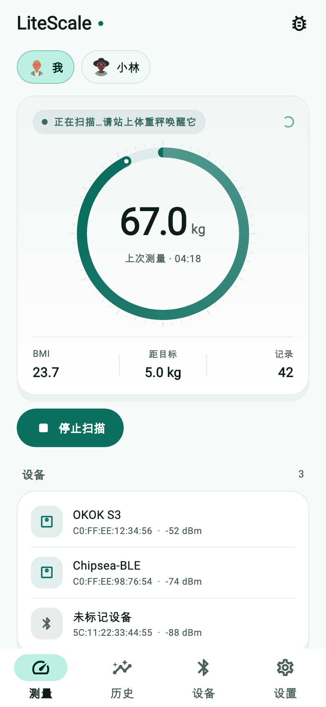
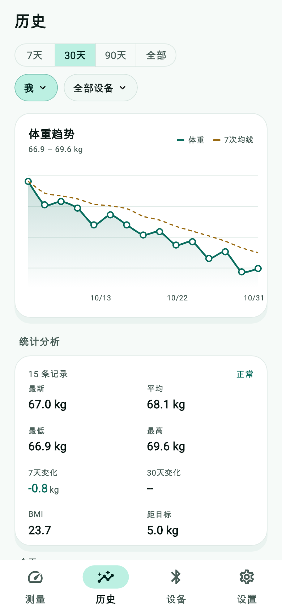
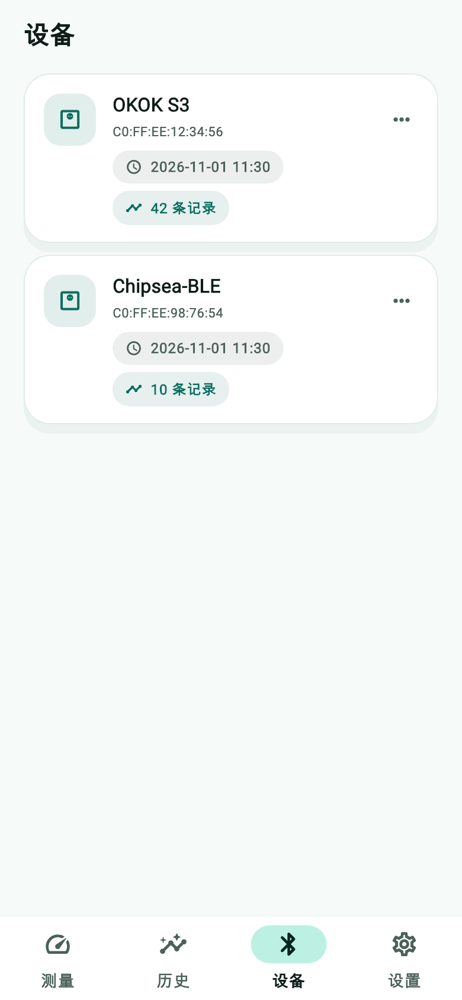
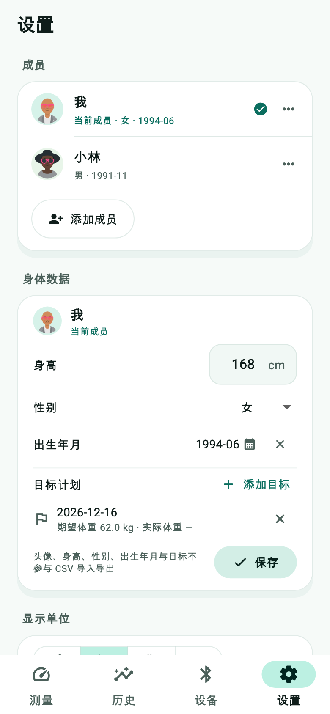
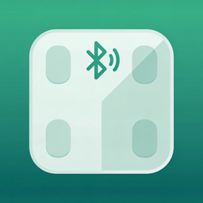

# LiteScale

<p>
  <a href="https://flutter.dev"></a>
  
  
  
</p>

[English](README.md) · **简体中文**

给 **OKOK / 芯海（Chipsea）蓝牙体重秤** 用的体重记录应用：不需要原厂 App、不需要账号、默认不联网。
直接解析秤的蓝牙广播包，数据全部留在本地；想同步时再接一台自建的 Odin 服务端。

| 测量 | 历史 | 设备 | 设置 |
|:--:|:--:|:--:|:--:|
|  |  |  |  |

<sub>截图由 `scripts/screenshots.sh` 从真实控件树渲染（2 倍图，iPhone 13 尺寸），UI 改动不同步时跑一次就能发现。</sub>

## 功能

* **只读广播，不连 GATT。** 秤把体重放在蓝牙广播里，应用解析广播包，所以秤还停在数字上时读数已经进 App 了。
* **家庭多成员。** 每位成员独立维护头像、身高、性别、出生月份，以及任意多个"带日期的目标"（目标日期 + 目标体重）。
* **四维筛选的历史。** 时间范围（7 / 30 / 90 天 / 全部）、成员、设备，外加单条记录改归属；图表叠加 7 日均线。
* **数据源可插拔。** 读数抽象成 `ScaleSource`，加新传输方式不用动页面。
* **CSV 进出自如。** 列结构与服务端一致，导出可直接再导入。
* **可选自建同步。** 设置里手动开启，靠内容哈希保证重试恰好一次。
* **微信小程序**：同一套协议、同一套数据模型、同一套 CSV 列。

## 目录结构

```
lib/                     Flutter 应用
  model/                 成员、称重记录、目标、头像
  source/                ScaleSource 接口 + 蓝牙广播解析
  service/               AppController（状态）、上传、CSV、单位、文件落盘
  view/                  theme.dart、四个页面、共享组件
  i18n/strings.dart      手写中英文案（不引 flutter_localizations）
server/                  Odin 同步服务端（opus + oboe，SQLite 存储）
miniprogram/             微信小程序（原生 JS，canvas 画图）
scripts/                 构建、打包、图标与截图工具
test/                    widget、CSV、头像、上传相关测试
docs/screenshots/        本 README 用到的截图
```

## 快速开始

依赖：Flutter 3.x、支持 BLE 的设备（Android 6+ / iOS 11+ / 桌面端）、以及一台 OKOK 或芯海方案的秤。

```bash
git clone https://git.home504.io/ryan/LiteScale.git
cd LiteScale
flutter pub get
flutter run
```

打开就在「测量」页扫描；扫描期间上秤，读数会出现。凡是产生过读数的秤都会记在「设备」页。

**Android 权限**（`android/app/src/main/AndroidManifest.xml` 里已声明）：

```xml
<uses-permission android:name="android.permission.BLUETOOTH_SCAN" android:usesPermissionFlags="neverForLocation" />
<uses-permission android:name="android.permission.BLUETOOTH_CONNECT" />
<uses-permission android:name="android.permission.ACCESS_FINE_LOCATION" />
```

## 构建与发版

版本号的唯一来源是 `pubspec.yaml` 的 `version:`（当前 `1.1.1+10`）。所有脚本都 source
`scripts/common.sh`，从项目本身推导名字，不写死字符串：

| 取值 | 来源 |
|---|---|
| 包名（`litescale`） | `pubspec.yaml` 的 `name:` |
| 显示名 / 产物名（`LiteScale`） | `macos/Runner/Configs/AppInfo.xcconfig` 的 `PRODUCT_NAME`（可用 `APP_NAME=...` 覆盖） |
| 版本号 / 构建号 | `pubspec.yaml` 的 `version:` |

产物落在 `dist/`，命名 `LiteScale-<版本>-<目标>`：

```bash
./scripts/build_android.sh      # dist/LiteScale-1.1.1-android-arm64-v8a.apk
./scripts/build_ios.sh          # dist/LiteScale-1.1.1-ios-arm64-unsigned.ipa  （macOS + Xcode）
./scripts/build_macos.sh arm64  # dist/LiteScale-1.1.1-macos-arm64.dmg        （仅 macOS）
./scripts/build_macos.sh x64    # dist/LiteScale-1.1.1-macos-x64.dmg          （仅 macOS）
./scripts/build_windows.sh      # dist/LiteScale-1.1.1-windows-x64.zip        （Windows + MSVC）
./scripts/build_server.sh       # dist/litescale-server-1.1.1-<os>-<arch>     （Odin，本机原生）
./scripts/build_server_linux.sh # dist/litescale-server-1.1.1-linux-x64       （有 zig 即可交叉编译）
./scripts/build_all.sh          # 本机能出的全部目标
```

发版前值得知道的几点：

* **应用标识** —— macOS / iOS / Linux 用 `top.xi-yun.litescale`，Android 用
  `top.xi_yun.litescale`（Java 包名不允许 `-`）。这是系统级身份，改了之后各平台都会当成全新应用，
  本地数据为空。
* **Android** 用 `--split-per-abi --target-platform android-arm64` 构建，APK 只带 `arm64-v8a`。
  Flutter 会按 split 重写 `versionCode`（`abiCode * 1000 + buildNumber`），所以构建号 `9`
  会显示成 `2009`，属正常。
* **macOS** 每次构建会改写 `macos/Runner/Configs/Arch.xcconfig`（Flutter CLI 无法把 `ARCHS`
  传给 xcodebuild）。产物是 ad-hoc 签名、未公证：首次打开要右键 → 打开；正式分发请用
  Developer ID 加 `notarytool`。
* **iOS** —— 两种模式：`./scripts/build_ios.sh unsigned`，或
  `IOS_TEAM_ID=XXXXXXXXXX ./scripts/build_ios.sh ipa`（另可用
  `EXPORT_METHOD=ad-hoc|app-store`）。两种都要装 iOS 平台组件
  （`xcodebuild -downloadPlatform iOS`）。
* **Windows** 不能交叉编译：在 Windows 上用 Visual Studio（含 C++ 桌面开发）跑
  `build_windows.sh`。
* **Linux 服务端** 可在任意机器交叉编译：Odin 出 `linux_amd64` 目标文件，zig 用它自带的 musl
  加上从源码编出的 sqlite3、zlib 静态链接，产出零依赖的单文件 ELF。
  `LINUX_TARGET=aarch64-linux-musl LINUX_ARCH=arm64` 可切成 arm64。
* Release APK 用 debug 签名（`android/app/build.gradle.kts` →
  `signingConfigs.getByName("debug")`），正式发布前请配置自己的 keystore。

## 服务端同步（可选）

设置页「服务端上传」会把成员（身高、性别、出生月份）、带日期的目标和测量数据推到自建服务端。
服务端是用 Odin 写的，HTTP 基于 `opus` + `oboe`，SQLite 作为唯一数据源 —— 协议格式、完整性校验、
管理台和部署细节见 [`server/README.md`](server/README.md)。

```bash
make -C server build && make -C server run   # http://127.0.0.1:9429/admin/
```

* 上传**默认关闭**，不手动开启不会有任何请求离开设备。
* 默认地址 `https://sc.xi-yun.top/`，可在设置里改。
* 每批请求都带 `X-Body-Sha256` 与由请求体推导的 `X-Idempotency-Key`，重试恰好一次；
  测量记录另有内容推导的服务端 UID。
* 上传是只增不改的：本地清空历史不会删服务端数据，删客户端及其数据要去管理台。

## 微信小程序

`miniprogram/` 是一个独立小程序：同样的只读广播协议、同样的数据模型、canvas 图表、同样的 CSV 列。

* 四个 Tab 与 App 一致：测量 / 历史 / 设备 / 设置。
* 记录存成 `{t, kg, m, d}`，旧版本的单成员数据在启动时迁移（`utils/store.js` ▸ `migrate`）。
* 导出写 `<USER_DATA_PATH>/litescale-YYYY-MM-DD.csv` 并调系统分享面板
  （`wx.shareFileMessage`）；开发者工具里退化为复制到剪贴板。导入用 `wx.chooseMessageFile`。
* 在 `miniprogram/project.config.json` 里填自己的 `appid`（占位值是 `touristappid`），
  然后用微信开发者工具导入该目录。
* 蓝牙扫描只能在真机上跑，模拟器不行。
* 改协议要改两处：`miniprogram/utils/protocol.js`（`parseAdvertisement`）**和**
  `lib/source/ble_adv_source.dart`。

## 数据模型与 CSV

```csv
ts,client_id,device_id,device_name,member_id,member_name,kg
1793000000.123,c-macos-1a2b3c4d,C0:FF:EE:12:34:56,OKOK S3,m-1,我,68.4
```

* `ts` 是 Unix 秒，固定三位小数；`kg` 永远是千克。
* `client_id` 是本机上传身份（首次同步时生成）；从未开启过上传的安装导出时为空。
* 导入先按表头名匹配（服务端导出可直接导入），忽略多余列，跳过时间或体重非法的行；
  未知成员名会自动创建，设备名会被记住。
* 兼容性放在最后：旧表头（`ts_ms`、`timestamp`、`weight_kg` 等）、整数毫秒时间戳、
  ISO-8601、无表头文件都还能导入。
* 导出是 UTF-8 **带 BOM**，Excel 可直接打开。
* 头像、身高、性别、出生月份、目标属于本地偏好，故意不进出 CSV。
* 单位：内部统一存千克，显示支持 kg / 斤 / lb / st:lb。

## 测量模型

秤只广播体重和一个未公开的阻抗字节，没有别的。所以 App 只显示体重、BMI 和目标进度；
体脂、水分、肌肉、基础代谢都去掉了 —— 那些数字只能是编的，不是测出来的。

## 界面设计

Material 3，湖绿色系手调色板，见 `lib/view/theme.dart`：

* `Brand` 放四个品牌色，`Insets` / `Radii` 定布局节奏。
* `buildAppTheme()` 让所有组件主题都从同一个 textTheme 派生，因此换 `fontFamily` 会全站生效 ——
  截图工具就是靠这一点注入字体的。
* 复用组件在 `lib/view/widgets/app_widgets.dart`：`AppCard`、`SectionHeader`、`StatTile`、
  `StatusPill`、`ChoicePill`、`EmptyState`、`WeightRing`。
* 控件一律用固有宽度（按钮、分段控件、104 px 数字输入框），不做通栏，短文案不会被拉成一条。
* 头像是 `assets/avatars/` 下的插画 PNG（DiceBear *avataaars*，来源见
  `assets/avatars/ATTRIBUTION.md`）；旧的 emoji 头像在加载时映射到固定的新 id。

## 应用图标



`scripts/icon_from_logo.py` 把 `app-logo.png` 裁边、镜像补边后生成 `app-icon-1024.png`，
并拆出 Android 自适应图标的两层（渐变底 + 秤盘前景），再由 `flutter_launcher_icons`
铺到各平台尺寸：

```bash
python3 scripts/icon_from_logo.py && flutter pub run flutter_launcher_icons
```

## 测试

```bash
flutter test             # widget、CSV、头像、上传开关
./scripts/screenshots.sh # 重新生成 docs/screenshots/*.png
```

截图工具（`tool/screenshots/screens_test.dart`）会造一个两成员家庭、替换蓝牙数据源、加载真实字体
（Flutter 测试环境自带字体是方块），再以 2 倍分辨率栅格化整个外壳 —— 上面那些图就是用户看到的同一套控件渲染出来的。

## 常见问题

| 现象 | 原因 / 处理 |
|---|---|
| `ANDROID_SPECIFIC_ERROR`、`Timed out` | 秤需要特定的连接时序；重试，并用 nRF Connect 看广播内容。 |
| Android 12+ 扫不到设备 | `BLUETOOTH_SCAN` 没授权，或系统定位服务关着。 |
| macOS 构建报 `module cache path …` | 项目目录被改过名 —— `flutter clean`，删掉 `macos/Pods` 和 `Podfile.lock`。 |
| `pod install` 报 `curl 56 … unexpected eof` | 代理打断了走 git 源的 pod 克隆：`git config --global http.version HTTP/1.1`。 |
| `flutter test` 报 `Invalid WebSocket upgrade` | 本机设了代理；用 `env -u HTTP_PROXY -u HTTPS_PROXY …` 跑。 |
| Gradle：`Could not read workspace metadata … metadata.bin` | 守护进程在跑时删了缓存：先 `./gradlew --stop`，再删 `~/.gradle/caches`。 |

## 协议参考

* OKOK 协议笔记：<https://github.com/oliexdev/openScale/files/5224454/OKOK.Protocol.pdf>
* 芯海方案体重秤讨论：<https://github.com/oliexdev/openScale/issues/496>
* 蓝牙抓包工具：[nRF Connect](https://www.nordicsemi.com/Products/Software-Tools/nRF-Connect-for-mobile)
* [`flutter_blue_plus`](https://pub.dev/packages/flutter_blue_plus)
